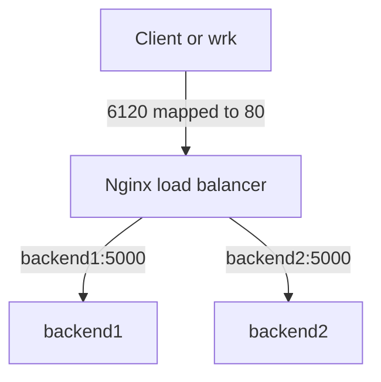

# CISC 7403 Project II — Group 2

Scalable Web Service with Load Balancing, Horizontal Scaling and Fault Tolerance.

成员：ZHANG HONGYI、HAN YAN。本项目使用 Nginx 分发请求，比较单后端与双后端的吞吐量、平均延迟和故障恢复情况。运行方式如下，实验数据见[实验记录](results/README.md)，报告见 [Project_II_Group_2.pdf](report/Project_II_Group_2.pdf)。

## 一键启动

在课程 Ubuntu 虚拟机准备 Docker Engine、Compose v2、Python 3、curl；性能实验另需 wrk。确认宿主机端口 6120 可用，然后在仓库根目录运行：

```bash
docker compose up --build
```

后台运行加 `-d`。默认项目名 `cisc7403-project2`，默认部署恰好三个容器：Nginx、backend1、backend2。

```bash
curl http://localhost:6120/
curl http://localhost:6120/work
docker compose ps
docker compose logs --tail=30
```

响应示例：`{"instance":"backend1","status":"ok"}`。具体实例由 Nginx 分配，不要求严格交替。

## 架构



两个后端在同一 Compose 网络中运行同一镜像 `cisc7403-backend:v1`，不发布宿主机端口。实例名通过 `INSTANCE_NAME` 注入。`/work` 使用 `time.sleep(0.05)`；每个后端仅一个 Python 服务进程，关闭请求多线程、debug 与自动重载。Nginx 连接上游超时为 1 秒，发生连接错误或超时时可尝试另一后端。

## 运行实验

```bash
bash scripts/check_backend.sh   # 独立后端自测
bash scripts/run_all.sh         # 负载均衡、故障恢复、性能实验
```

也可单独运行 `check_balance.sh`、`check_failover.sh`、`benchmark.sh`。实验会重建本项目容器，结束后双后端继续运行；共用虚拟机时请勿并行修改容器或运行其他压测。每轮保存环境、配置、源码校验值、全部请求及原始 wrk 输出，失败记录也会保留。

性能实验使用 2 个 wrk 线程、20 条连接、10 秒测量、5 秒超时，每种模式重复 3 次，记录吞吐量和平均延迟。

## 单后端与双后端

```bash
bash scripts/set_mode.sh single
bash scripts/set_mode.sh dual
```

单后端使用独立 `docker-compose.single.yml`，实际只运行一个后端，且 upstream 只有它。故障实验保留双 upstream 后停止容器。两种实验不能混用。完整检查、恢复和手动命令见 [集成运行说明](docs/integration_runbook.md)。

## 文件导航

| 路径 | 内容 |
| --- | --- |
| `backend/` | Flask 应用、锁定的依赖、Dockerfile 与构建上下文 |
| `docker-compose.yml` | 默认三个容器，课程要求的一键启动入口 |
| `docker-compose.single.yml` | 独立单后端性能配置 |
| `nginx/` | 双后端与单后端代理配置 |
| `scripts/` | 后端验收、模式切换与三个实验 |
| `results/` | 请求记录、容器日志、性能数据、环境和源码校验值 |
| `report/` | 3 页英文报告及 Markdown 源稿 |
| `docs/` | 运行说明与课程要求对应表 |

成员贡献列于报告第 6 节。个人分工声明随提交包提供。

## 停止服务

```bash
docker compose down --remove-orphans
```

## 提交材料

提交材料包含报告、源代码、Dockerfile、Nginx 配置、Compose 文件及分工声明。报告数据对应 `results/` 中的实验记录；详细操作步骤见[集成运行说明](docs/integration_runbook.md)，课程要求对应关系见[对照表](docs/requirements_checklist.md)。
