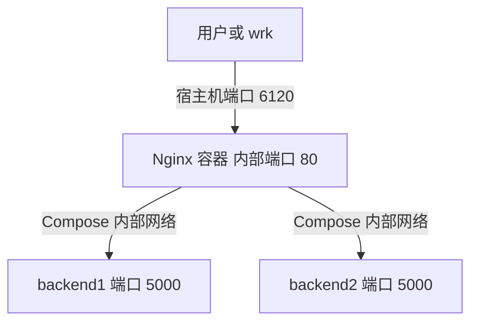

# CISC 7403 Project II

Scalable Web Service with Load Balancing, Horizontal Scaling and Fault Tolerance.

当前进度：已建立分工文档和基础目录。后端程序、Dockerfile、Nginx 配置和 Compose 部署文件由双方按分工实现；完整系统接通后开展实验。

## 分工与分支

| 成员 | 工作分支 | 主要职责 | 详细说明 |
| --- | --- | --- | --- |
| zhanghongyi | `zhanghongyi` | 后端、应用镜像、基础环境、性能实验、README | [工作范围与交接说明](docs/zhanghongyi_工作范围与交接说明.md) |
| hanyan | `hanyan` | Nginx、Compose、负载均衡与容错实验、报告排版 | [工作范围与交接说明](docs/hanyan_工作范围与交接说明.md) |

总体按预计工作量各承担约 50%，报告各写约一半。`main` 汇总双方核对通过的成果。

## 目标系统架构



- 两个后端使用同一个镜像 `cisc7403-backend:v1`。
- 后端监听 `0.0.0.0:5000`，通过 `INSTANCE_NAME` 区分实例。
- `GET /` 返回实例信息；`GET /work` 等待约 50 ms 后返回。
- 两个接口均返回 JSON，至少包含 `instance` 和 `status`。
- 每个后端仅一个服务进程，关闭请求多线程；使用 Flask 时设置 `threaded=False`、`debug=False`、`use_reloader=False`。
- 仅 Nginx 映射 `6120:80`；后端不发布宿主机端口。

6120 端口及并发限制来自作业要求；5000 内部端口、镜像名、实例变量与 JSON 字段是小组交接约定。

## 当前目录

```text
.
├── README.md
├── .gitignore
├── .editorconfig
├── backend/
│   ├── README.md
│   └── .dockerignore
├── nginx/
│   └── README.md
├── scripts/
│   └── README.md
├── docs/
│   ├── README.md
│   ├── zhanghongyi_工作范围与交接说明.md
│   └── hanyan_工作范围与交接说明.md
├── results/
│   ├── README.md
│   ├── backend/
│   ├── load_balancing/
│   ├── fault_tolerance/
│   └── performance/
└── report/
    └── README.md
```

`results/` 的各子目录用 `.gitkeep` 保留，实验完成后保存真实输出和必要截图。

后续主要文件：

| 负责人 | 需要补齐的文件 |
| --- | --- |
| zhanghongyi | `backend/app.py`、`backend/requirements.txt`、`backend/Dockerfile`、`docs/backend_handoff.md`、`scripts/benchmark.sh`、`docs/report_zhanghongyi.md` |
| hanyan | `nginx/nginx.conf`、根目录 `docker-compose.yml`、`docs/integration_runbook.md`、`scripts/check_balance.sh`、`scripts/check_failover.sh`、`docs/report_hanyan.md` |
| 双方 | `report/` 中最终报告与成员分工声明；README 最终运行步骤 |

## 开发与交接顺序

1. zhanghongyi 在同名分支完成后端、镜像、环境说明和自测，推送后提供提交 SHA 与 `docs/backend_handoff.md`。
2. hanyan 在同名分支接入该提交，完成 Nginx 和 Compose，提供可运行系统及单后端、双后端切换说明。
3. zhanghongyi 合并集成提交后运行性能实验；hanyan 完成负载均衡及容错实验。共用虚拟机时错开测试时段。
4. 双方各写约一半报告，核对原始证据后合并成果到 `main`，共同完成最终验收。

个人分支由各自在开始开发时创建并推送。hanyan 接入后端时，以 zhanghongyi 提供的交接提交为准；具体流程见各自分工文档。

## 运行与实验入口

以下为实现完成后需要支持的入口。当前基础目录尚未包含可运行服务。

在课程虚拟机准备 Docker、Docker Compose 和 `wrk`，完整系统应支持：

```bash
docker compose up --build
```

系统接通后的基本检查与性能负载示例：

```bash
curl http://localhost:6120/
curl http://localhost:6120/work
wrk -t2 -c20 -d10s http://localhost:6120/work
```

需要完成并保留证据的实验：

- 负载均衡：证明两个实例都处理了请求。
- 容错：双后端配置下停止一个后端，验证剩余实例继续响应，再恢复被停止的后端。
- 性能：使用相同负载比较单后端与双后端，记录吞吐量和平均延迟。单后端性能模式与故障实验分别记录配置。

## 最终提交检查

- 报告正文不超过 3 页，封面如有另计。
- 提交完整源代码、后端 Dockerfile、Nginx 配置和 `docker-compose.yml`。
- 报告包含架构说明、部署方法、三个实验的证据与结果、讨论和成员贡献。
- 整理小组分工声明表，由双方核对实际贡献。
- 在课程虚拟机从仓库内容复现启动与实验。

作业依据为课程提供的 Project II PDF 和 Role Declaration Page，原始教学文件由小组保管。
