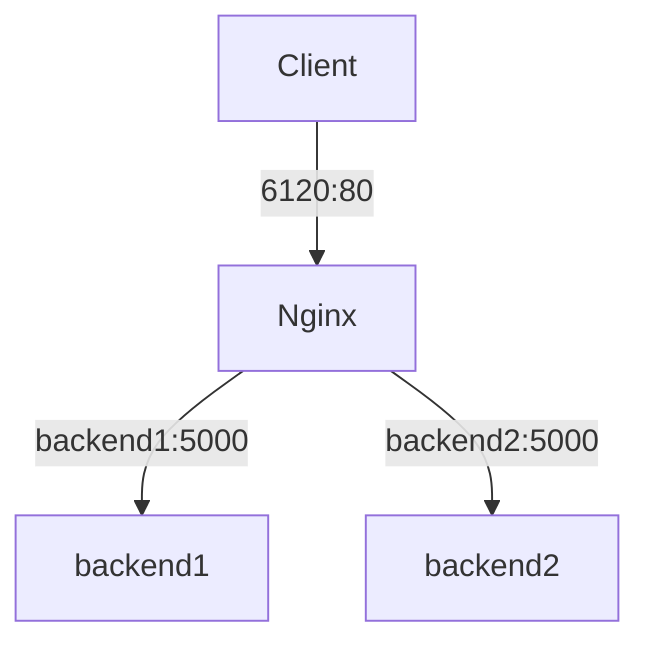

# 后端与性能章节

摘自[项目报告](../report/Project_II_Group_2.pdf)。成员贡献见报告第 6 节。

## 1 System architecture and backend



The backend exposes / and /work. Both return JSON containing an instance identifier and status; /work sleeps for 0.05 seconds. The instance comes from INSTANCE_NAME, falling back to the container hostname. Each container runs one Python server process with threaded=False, debug and reloading disabled. Runtime checks confirm one process and one thread, so requests queue within each backend.

The Dockerfile uses a pinned Python 3.12 base and pinned Flask dependencies, runs as a non-root user, and writes request logs to standard output/error. Both backends use the same application image, cisc7403-backend:v1; the experiment verifies matching image IDs.

## 2 Deployment and networking

| Component | Deployment responsibility |
| --- | --- |
| nginx | Official nginx:alpine image; only published port is host 6120 to container 80. |
| backend1 / backend2 | Same application image; unique INSTANCE_NAME; no host port bindings. |
| app_net | Compose bridge network; Nginx reaches services by backend1:5000 and backend2:5000. |

The default Compose file starts all three containers with one command. Nginx uses a round-robin upstream, a 1-second connection timeout, and retry on connection error or timeout. A separate single-backend Compose file mounts a configuration containing only backend1; mode changes recreate Nginx so the active configuration matches the intended experiment.

```text
docker compose up --build
curl http://localhost:6120/work
docker compose logs --tail=30
```

Source: backend/, nginx/, docker-compose.yml and docker-compose.single.yml. Full commands: README.md and docs/integration_runbook.md.

## 5 Performance experiment

The test VM ran Ubuntu 24.04 on aarch64 with 4 vCPUs and 7.7 GiB RAM. Software versions were Docker 29.8.2, Compose 5.6.0 and wrk 4.1.0. Three pairs of trials alternated between one and two backends, using the same wrk client and /work endpoint. Each trial warmed up for 3 seconds, waited 2 seconds for pending requests to finish, then measured for 10 seconds.

```text
wrk -t2 -c20 -d10s --timeout 5s --latency \
    http://127.0.0.1:6120/work
```

Single-backend trials ran only backend1 and nginx, and the upstream contained only backend1. Before each measurement, the script checked running services, upstream entries, image IDs, process and thread counts, and port bindings.

| Trial | 1 backend req/s | 1 backend latency ms | 2 backends req/s | 2 backends latency ms |
| --- | --- | --- | --- | --- |
| 1 | 18.81 | 1010.00 | 37.52 | 515.99 |
| 2 | 18.84 | 1010.00 | 37.41 | 519.63 |
| 3 | 18.82 | 1010.00 | 37.67 | 516.02 |
| Mean | 18.82 | 1010.00 | 37.53 | 517.21 |

Latency is wrk's reported average, converted to milliseconds. Means are arithmetic averages of the three displayed trial measurements; the original single-backend output reports latency as 1.01 s. All six trials reported zero socket errors (including timeouts) and no non-2xx/3xx responses. Raw outputs: results/performance/20261120T153935Z-31487/<trial-mode>/wrk.txt.

## Discussion and limitations

Throughput rose from 18.82 to 37.53 requests/s (1.99x); average latency fell from 1010.00 to 517.21 ms. A serial 50 ms handler has an ideal capacity near 20 requests/s, or 40 for two independent replicas. The measured rates are slightly lower because of application, connection and scheduling overhead. With 20 concurrent connections, requests queue behind the serial handler, explaining latency well above 50 ms. Adding a backend reduces queueing and almost doubles capacity.

The result applies to this 50 ms waiting workload and these short trials. Longer tests and different workloads would be needed to assess production capacity. Nginx remains a single point of failure, and passive failover can add about one second. Other course containers were running on the VM, which also hosted wrk, so shared resources may have affected the measurements.

## 6 Member contributions

ZHANG HONGYI: backend and Dockerfile; environment setup and backend tests; integration fixes, experiment scripts, performance analysis and final report. HAN YAN: initial Nginx load balancer, Docker Compose deployment and integration instructions.

Reproduce all experiments with bash scripts/run_all.sh. The final source matches the SHA-256 manifest in results/acceptance/20261120T153935Z-31487/source-sha256.json. Full evidence index: results/README.md.

[1] Nginx proxy module: nginx.org/en/docs/http/ngx_http_proxy_module.html
[2] Course Project II specification, Sections 3.1-3.6.
