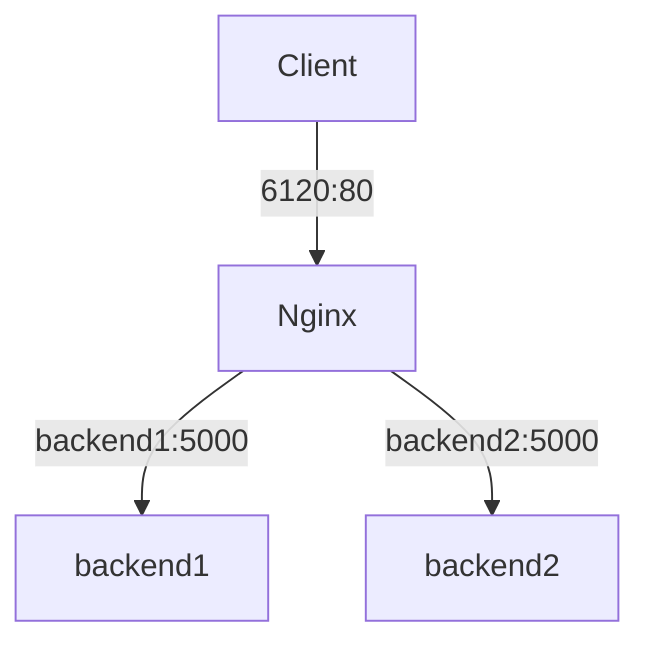

# CISC 7403 Project II

Scalable Web Service with Load Balancing

CISC 7403 Project II   |   Group 2   |   20 November 2026
ZHANG HONGYI and HAN YAN

Two identical single-threaded Flask backends run behind Nginx on the course virtual machine. The completed deployment distributed requests to both instances and remained responsive after either backend was stopped. Across three paired wrk trials, two backends delivered 1.99 times the throughput of one backend.

## 1 System architecture and backend



The backend exposes / and /work. Both return JSON containing an instance identifier and status; /work sleeps for 0.05 seconds. The instance comes from INSTANCE_NAME, falling back to the container hostname. Each container runs one Python server process with threaded=False, debug and reloading disabled. Runtime checks confirm one process and one thread, so requests queue within each backend.

The Dockerfile uses a pinned Python 3.12 base and pinned Flask dependencies, runs as a non-root user, and writes request logs to standard output/error. Both backends use the same application image, cisc7403-backend:v1; the experiment verifies matching image IDs.

## 2 Deployment and networking

| Component | Deployment responsibility |
| --- | --- |
| nginx | Official nginx:alpine image; only published port is host 6120 to container 80. |
| backend1 / backend2 | Same application image; unique INSTANCE_NAME; no host port bindings. |
| app_net | Compose bridge network; Nginx reaches services by backend1:5000 and backend2:5000. |

The default Compose file starts all three containers with one command. Nginx uses a round-robin upstream, a 1-second connection timeout, and retry on connection error or timeout. A separate single-backend Compose file mounts a configuration containing only backend1; mode changes recreate Nginx so the active configuration matches the intended experiment.

```text
docker compose up --build
curl http://localhost:6120/work
docker compose logs --tail=30
```

Source: backend/, nginx/, docker-compose.yml and docker-compose.single.yml. Full commands: README.md and docs/integration_runbook.md.

## 3 Load balancing verification

The final acceptance run sent 40 sequential requests, alternating between / and /work, through port 6120. All returned HTTP 200 and valid JSON. backend1 handled 20 requests and backend2 handled 20. The requirement is that both instances receive requests; strict alternation is not assumed by the check.

```text
{"instance":"backend1","status":"ok"}
{"instance":"backend2","status":"ok"}
```

These response bodies are reproduced from the recorded successful requests. The request file includes timestamps, paths, HTTP status, instance, content type and elapsed time; backend container logs provide corresponding request evidence.

## 4 Backend failure and recovery

With both upstream entries retained, the experiment stopped backend1, sent 30 requests, restarted it and verified that both instances served requests again. It repeated the same procedure for backend2. The diagnostic client used a 3-second timeout; this is our acceptance threshold, not a time limit specified by the assignment.

| State | Responses | Instance distribution | Failures |
| --- | --- | --- | --- |
| Initial dual backend | 20 / 20 | backend1 10; backend2 10 | 0 |
| backend1 stopped | 30 / 30 | backend2 30 | 0 |
| backend1 restored | 20 / 20 | backend1 10; backend2 10 | 0 |
| backend2 stopped | 30 / 30 | backend1 30 | 0 |
| backend2 restored | 20 / 20 | backend1 10; backend2 10 | 0 |

The maximum response times while backend1 and backend2 were stopped were 1055.97 ms and 1006.32 ms respectively. Thus availability was preserved in these samples, but failover was not instantaneous. Recovery polling also succeeded without failed requests; after the passive failure window, the restarted instances rejoined request handling.

## Challenge and correction

Before the correction, the merged configuration had no explicit connection timeout. In the same VM, stopping backend1 produced 15 client timeouts in 30 attempts, and stopping backend2 produced 13 in 30, using the same 3-second diagnostic limit. These were client timeouts, not observed HTTP 504 responses. Nginx logs showed aborted requests and an unreachable stopped upstream.

Adding proxy_connect_timeout 1s lets connection failure be detected within the client threshold, after which Nginx can try the surviving backend. The final configuration explicitly allows error/timeout retries and at most two upstream attempts [1]. No automatic container restart or high-availability Nginx was added, as neither is required.

## Evidence and reproduction

```text
bash scripts/check_balance.sh
bash scripts/check_failover.sh
```

Final run ID: 20261120T153935Z-31487. See results/load_balancing/<run ID>/ and results/fault_tolerance/<run ID>/ for summaries, requests.jsonl, effective Nginx configuration, stop/start records and container logs. Earlier failure evidence is retained in results/fault_tolerance/pre-fix-20261120/.

## 5 Performance experiment

Measurements ran on Ubuntu 24.04 (aarch64, 4 vCPUs, 7.7 GiB RAM), Docker 29.8.2, Compose 5.6.0 and wrk 4.1.0. Each mode used the same client and /work endpoint. Three paired trials alternated one backend and two backends. Each trial used a 3-second warm-up and a 2-second drain period before the 10-second measurement. Only the timed output enters the table.

```text
wrk -t2 -c20 -d10s --timeout 5s --latency \
    http://127.0.0.1:6120/work
```

The single-backend configuration ran only backend1 and nginx, with only backend1 in the upstream. It did not leave a stopped server in the upstream. Each trial checked active services, upstream entries, image IDs, process/thread counts and port bindings before timing.

| Trial | 1 backend req/s | 1 backend latency ms | 2 backends req/s | 2 backends latency ms |
| --- | --- | --- | --- | --- |
| 1 | 18.81 | 1010.00 | 37.52 | 515.99 |
| 2 | 18.84 | 1010.00 | 37.41 | 519.63 |
| 3 | 18.82 | 1010.00 | 37.67 | 516.02 |
| Mean | 18.82 | 1010.00 | 37.53 | 517.21 |

Latency is wrk's reported average, converted to milliseconds. Means are arithmetic averages of the three displayed trial measurements; the original single-backend output has 1.01 s precision. All six trials reported zero socket errors (including timeouts) and no non-2xx/3xx responses. Raw outputs: results/performance/20261120T153935Z-31487/<trial-mode>/wrk.txt.

## Discussion and limitations

Throughput rose from 18.82 to 37.53 requests/s (1.99x); average latency fell from 1010.00 to 517.21 ms. A serial 50 ms handler has an ideal capacity near 20 requests/s, or 40 for two independent replicas. The measured rates are slightly lower because of application, connection and scheduling overhead. With 20 concurrent connections, requests queue behind the serial handler, explaining latency well above 50 ms. Adding a backend reduces queueing and almost doubles capacity.

These short trials demonstrate horizontal scaling for an artificial waiting workload. They do not establish long-term reliability or production capacity. Nginx remains a single point of failure; passive failover can add about one second. The VM also hosted other course containers, and wrk ran on the same VM. Image IDs and environment details are recorded for interpretation and reproduction.

## 6 Member contributions

ZHANG HONGYI: backend, Dockerfile, environment and backend self-tests; subsequent integration corrections, repeatable experiments, performance analysis and consolidated report. HAN YAN: initial Nginx load balancer, Docker Compose deployment and integration runbook. The initial plan divided responsibilities approximately equally; these statements describe delivered components rather than claiming exact measured hours.

Reproduce all experiments with bash scripts/run_all.sh. The final source matches the SHA-256 manifest in results/acceptance/20261120T153935Z-31487/source-sha256.json. Full evidence index: results/README.md.

[1] Nginx proxy module: nginx.org/en/docs/http/ngx_http_proxy_module.html
[2] Course Project II specification, Sections 3.1-3.6.
