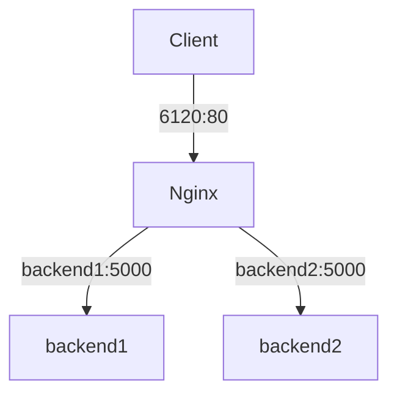

# CISC 7403 Project II

Scalable Web Service with Load Balancing

CISC 7403 Project II   |   Group 2   |   20 November 2026
ZHANG HONGYI and HAN YAN

This project runs two identical Flask backends behind Nginx on the course virtual machine. Requests reached both instances, and the service continued responding when either backend was stopped. In three paired wrk trials, adding the second backend increased throughput from 18.82 to 37.53 requests/s.

## 1 System architecture and backend



The backend exposes / and /work. Both return JSON containing an instance identifier and status; /work sleeps for 0.05 seconds. The instance comes from INSTANCE_NAME, falling back to the container hostname. Each container runs one Python server process with threaded=False, debug and reloading disabled. Runtime checks confirm one process and one thread, so requests queue within each backend.

The Dockerfile uses a pinned Python 3.12 base and pinned Flask dependencies, runs as a non-root user, and writes request logs to standard output/error. Both backends use the same application image, cisc7403-backend:v1; the experiment verifies matching image IDs.

## 2 Deployment and networking

| Component | Deployment responsibility |
| --- | --- |
| nginx | Official nginx:alpine image; only published port is host 6120 to container 80. |
| backend1 / backend2 | Same application image; unique INSTANCE_NAME; no host port bindings. |
| app_net | Compose bridge network; Nginx reaches services by backend1:5000 and backend2:5000. |

The default Compose file starts all three containers with one command. Nginx uses a round-robin upstream, a 1-second connection timeout, and retry on connection error or timeout. A separate single-backend Compose file mounts a configuration containing only backend1; mode changes recreate Nginx so the active configuration matches the intended experiment.

```text
docker compose up --build
curl http://localhost:6120/work
docker compose logs --tail=30
```

Run these commands from the source directory in the submitted package.

## 3 Load balancing verification

The load-balancing test sent 40 sequential requests through port 6120, alternating between / and /work. All returned HTTP 200 and valid JSON. Each backend handled 20 requests. The test checks that both instances respond; it does not require the response sequence to alternate strictly.

```text
{"instance":"backend1","status":"ok"}
{"instance":"backend2","status":"ok"}
```

The examples above come from the request log. Each entry records the timestamp, path, HTTP status, responding instance, content type and elapsed time. Container logs record the requests handled by each backend.

## 4 Backend failure and recovery

The failure test kept both servers in the Nginx upstream, stopped backend1 and sent 30 requests. After restarting backend1, it checked that both instances served requests again. The same procedure was then repeated for backend2. The test client used a 3-second timeout.

| State | Responses | Instance distribution | Failures |
| --- | --- | --- | --- |
| Initial dual backend | 20 / 20 | backend1 10; backend2 10 | 0 |
| backend1 stopped | 30 / 30 | backend2 30 | 0 |
| backend1 restored | 20 / 20 | backend1 10; backend2 10 | 0 |
| backend2 stopped | 30 / 30 | backend1 30 | 0 |
| backend2 restored | 20 / 20 | backend1 10; backend2 10 | 0 |

With backend1 stopped, the slowest response took 1055.97 ms; with backend2 stopped, it took 1006.32 ms. All sampled requests succeeded, although switching to the remaining backend could add about one second. Recovery polling also completed without failed requests. Both instances handled requests again after each restart.

## Challenge and correction

The first integrated configuration had no explicit upstream connection timeout. On the same VM and with the same 3-second client limit, stopping backend1 caused 15 of 30 requests to time out; stopping backend2 caused 13 of 30 to time out. The client received no HTTP response for these requests. Nginx logs recorded aborted requests and an unreachable upstream.

Setting proxy_connect_timeout 1s limits the wait for an upstream connection. Nginx can then retry the request on the remaining backend before the client times out. The configuration permits retries on connection errors and timeouts, with at most two upstream attempts. The repeated tests shown above had no failed requests.

## Reproducing the checks

```text
curl http://localhost:6120/
docker compose stop backend1
curl --max-time 3 http://localhost:6120/
docker compose start backend1
```

Repeat requests to observe both instance IDs. Repeat the stop/start sequence for backend2. After each restart, allow Nginx to resume sending requests to both backends.

## 5 Performance experiment

The test VM ran Ubuntu 24.04 on aarch64 with 4 vCPUs and 7.7 GiB RAM. Software versions were Docker 29.8.2, Compose 5.6.0 and wrk 4.1.0. Three pairs of trials alternated between one and two backends, using the same wrk client and /work endpoint. Each trial warmed up for 3 seconds, waited 2 seconds for pending requests to finish, then measured for 10 seconds.

```text
wrk -t2 -c20 -d10s --timeout 5s --latency \
    http://127.0.0.1:6120/work
```

Single-backend trials used docker-compose.single.yml and nginx/nginx.single.conf, running only backend1 and nginx. To switch configurations, first run docker compose down --remove-orphans. Start one backend with docker compose -f docker-compose.single.yml up --build -d, or two backends with docker compose up --build -d. Use the same wrk command for both configurations.

| Configuration | Throughput (req/s) | Average Latency (ms) |
| --- | --- | --- |
| 1 backend | 18.82 | 1010.00 |
| 2 backends | 37.53 | 517.21 |

The table reports the arithmetic mean of three trials for each configuration. Latency is wrk's average request latency, converted to milliseconds.

Across trials 1-3, throughput was 18.81, 18.84 and 18.82 req/s with one backend, and 37.52, 37.41 and 37.67 req/s with two. The corresponding average latencies were 1010.00, 1010.00 and 1010.00 ms with one backend, and 515.99, 519.63 and 516.02 ms with two.

The original single-backend output reports latency as 1.01 s. All six trials reported zero socket errors (including timeouts) and no non-2xx/3xx responses.

## Discussion and limitations

Throughput rose from 18.82 to 37.53 requests/s (1.99x); average latency fell from 1010.00 to 517.21 ms. A serial 50 ms handler has an ideal capacity near 20 requests/s, or 40 for two independent replicas. The measured rates are slightly lower because of application, connection and scheduling overhead. With 20 concurrent connections, requests queue behind the serial handler, explaining latency well above 50 ms. Adding a backend reduces queueing and almost doubles capacity.

The result applies to this 50 ms waiting workload and these short trials. Longer tests and different workloads would be needed to assess production capacity. Nginx remains a single point of failure, and passive failover can add about one second. Other course containers were running on the VM, which also hosted wrk, so shared resources may have affected the measurements.

## 6 Member contributions

The overall workload was shared approximately equally: ZHANG HONGYI 50%; HAN YAN 50%. Zhang handled the backend and Dockerfile, environment setup, backend tests, integration fixes, experiment scripts, performance analysis and final report. Han handled the Nginx load balancer, Docker Compose deployment, service networking and integration instructions.
